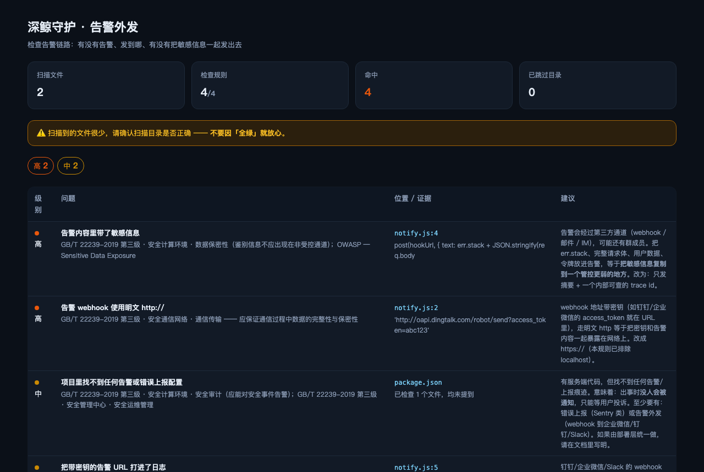

# @deepwhale-cn/dsh-alert-relay

[](https://dsh-plugin.org/plugins/feely0208/dsh-alert-relay)

**告警外发** —— 检查告警链路：有没有告警、发到哪、有没有把敏感信息一起发出去。

## 不装它会怎样

出事时你的告警是这么发的：

```js
post(webhook, { text: err.stack + JSON.stringify(req.body) })
```

**告警通道通常是整个系统里管控最弱的一条出口**：

```
数据库：内网、有审计、有权限控制
告警 webhook：一个 URL，谁拿到谁就能发
```

把 `err.stack`、完整请求体、用户数据塞进去，等于**把敏感信息复制到一个管控更弱的地方**。

## 它查什么

| 级别 | 内容 |
|---|---|
| 🔴 高 | 告警内容带敏感信息 · webhook 明文 http:// |
| 🟡 中 | 把带密钥的告警 URL 打进日志 · 找不到任何告警配置 |

## 正确做法

```
❌ post(webhook, { text: err.stack + JSON.stringify(req.body) })
✅ post(webhook, { text: `[ERROR] trace=${traceId}` })
```

**只发摘要 + trace id**，细节放在有权限控制的地方。

## 安装

```bash
dsh plugin --profile web add @deepwhale-cn/dsh-alert-relay
# 或纯 CLI
npx @deepwhale-cn/dsh-alert-relay
```

## 用法

```bash
dsh-alert-relay --demo
dsh-alert-relay --list-rules
dsh-alert-relay --html r.html
```



## 边界

- **不验证告警真能发出去** —— 只看配置与代码。
- **「找不到告警配置」是弱信号** —— 可能由部署层统一做，报出来是提示你确认。
- 与 [dsh-cn-log-retention](https://github.com/feely0208/dsh-cn-log-retention) 分工：那个查日志留多久，这个查告警发去哪。

本插件是一个工具。使用者必须遵守所在地区法律法规，**对使用本项目造成的任何后果自行承担责任。**

## License

MIT © 深鲸 DeepWhale
